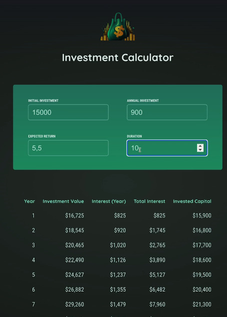

- diplay header, fetching user input & outputting the results table
- fetch & store uer input (ie, the entered investment paramaters)
- derive investment results with the help of the provided utilitiy function
- display investment results in a html table
- conditionally display an info message if an invalid duration (<1) was entered

